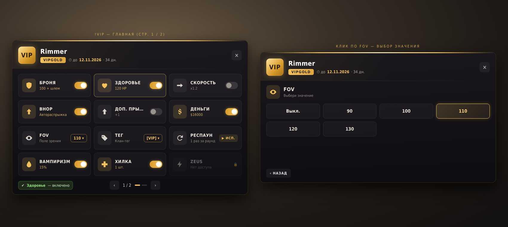
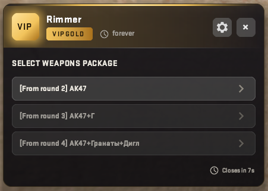
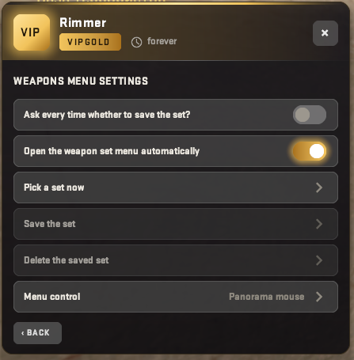

# PMM_VIPCore

<h2><a href="https://genesis-cs.space/menuconstructor/index.html">>>>Более подробная информация на сайте<<<</a></h2>



<p>
  
  
</p>

Bridge by **Rimmer** between [VIPCore](https://github.com/partiusfabaa/cs2-VIPCore) (thesamefabius) and [PanoramaMenuManager](https://github.com/RRimmer/PanoramaMenuManagerCS2) (MenuManagerCS2 1.2.03). VIPCore and its modules are not changed: Harmony patches them at runtime.

Current version: **0.1.5**. Needs CounterStrikeSharp 1.0.378 (.NET 10), VIPCore 2.x (partiusfabaa) or VIPCore 1.x (v1.3.3) and MenuManager 1.2.03 (1.2.05 for the WeaponsMenu digits mode). New in 0.1.5: VIPCore 2 support (`MenuType: center`), translations in `lang/ru.json` / `lang/en.json`, see CHANGELOG.

- `!vip` and every VIP module menu open in MenuManager (the player's menu type from `!menu`).
- Own VIP panorama for PanoramaMenu players: nickname, VIP group and expiry in the header, 3×4 tiles with CS2 icons,
  values from `vip.json`, switches, value pickers (Fov, Tag), "No access" tiles, sub menus with "Back".
- Switches and pickers change in place — the menu does not jump back to page 1.
- Colours of the panel and of every VIP group are set in the config (`Paint.Theme`).
- All names and texts are edited in `plugins/PMM_VIPCore/lang/ru.json` / `en.json` (per player language).

## WeaponsMenu (VIP_WeaponsMenu)

The weapons menu of the original VIP_WeaponsMenu module opens in a compact panel (6 rows, left by default) with a
"Closes in N s" countdown. The gear ⚙ in the header and the chat command `!swm` open the player's settings:

| Setting | What it does |
| --- | --- |
| Ask every time whether to save the set? | On by default. Off — "Save this set?" is never asked again (also after a map change or restart), the set is saved in the settings |
| Open the weapon set menu automatically | Off — the menu does not pop up on spawn, use "Pick a set now" |
| Pick a set now | Opens the weapons list (alive, buy zone, buy time and round are checked by the module) |
| Save the set / Save set «X» | Saves the set taken last |
| Delete the saved set | The weapons menu shows up again on the next spawn |
| Menu control | Panorama mouse / Panorama WASD / Panorama digits (digits: PMM Core 1.2.05, number keys check on the first pick) |

WASD: W / S move, E take, A / D page, R settings. Digits: 1–6 take, 7 settings, 8 / 9 page, 0 close.
Player settings are saved per SteamID in `plugins/PMM_VIPCore/weaponsmenu_players.json`; server defaults are in the
`WeaponsMenu` section of the config.

## Repository layout

| Folder | What it is |
| --- | --- |
| `PMM_VIPCore` | The plugin: `Plugin.cs` (Harmony, commands), `Bridge.cs` (VIPCore → MenuManager), `Paint.cs` (VIP panorama), `Theme.cs` + `theme.template.css` (colours), `CoreCompat.cs` (VIPCore 1.x / 2.x), `WeaponsMenu.cs` (WeaponsMenu, `!swm`), `Translations.cs`, `Config.cs` |
| `PMM_VIPCore/panorama` | Client files for the MultiAddonManager addon: `pmm_vip.xml`, `pmm_vip.css`, `pmm_vip_theme.css` |
| `PMM_VIPCore/lang` | `ru.json`, `en.json` — texts (copied next to the DLL) |
| `PMM_VIPCore/lib` | `0Harmony.dll` (Lib.Harmony 2.4.2, net10.0) |
| `tools` | `gen_layout.py` — generates the panorama files (`python3 tools/gen_layout.py PMM_VIPCore`) |
| `MenuManagerApi` | Compile-time library. Do not copy `MenuManagerApi.dll` next to this plugin |
| `configs` | Example config |

## Install from a Release

Copy `Server-plugins/counterstrikesharp` into `game/csgo/addons/`. You get:

- `plugins/PMM_VIPCore/PMM_VIPCore.dll`
- `plugins/PMM_VIPCore/harmony/0Harmony.dll`
- `plugins/PMM_VIPCore/lang/ru.json`, `en.json`
- `configs/plugins/PMM_VIPCore/PMM_VIPCore.json`

`0Harmony.dll` stays only in `harmony/`. Restart the server after an install or update: `css_plugins reload` does not unload Harmony.
Use the original VIP_Fov / VIP_Tag builds — the ones from the old PMM fork fail with `MissingMethodException`.

Copy `Content-addonmanager/panorama` into the MultiAddonManager addon and rebuild it. After changing `Paint.Theme`
the plugin writes `pmm_vip_theme.css` next to its DLL (`css_pmm_vip css`); copy it into the addon and rebuild.

Chat: `!swm` (WeaponsMenu settings). Server console: `css_pmm_vip` (status), `css_pmm_vip repatch`, `css_pmm_vip css`.

Full guide: [INSTALL.md](INSTALL.md).

## Build

You need the .NET 10 SDK.

```bash
dotnet build PMM_VIPCore.sln --configuration Release
```

Output: `PMM_VIPCore/bin/Release/net10.0/`. Ship `PMM_VIPCore.dll` and `harmony/0Harmony.dll`. Do not ship `CounterStrikeSharp.API.dll` or `MenuManagerApi.dll`.

The changelog is in [CHANGELOG.md](CHANGELOG.md).

## License

[GNU GPL v3](LICENSE).

---

# PMM_VIPCore

<h2><a href="https://genesis-cs.space/menuconstructor/index.html">>>>Более подробная информация на сайте<<<</a></h2>

Мост от **Rimmer** между [VIPCore](https://github.com/partiusfabaa/cs2-VIPCore) (thesamefabius) и [PanoramaMenuManager](https://github.com/RRimmer/PanoramaMenuManagerCS2) (MenuManagerCS2 1.2.03). VIPCore и модули не меняются: Harmony патчит их в рантайме.

Текущая версия: **0.1.5**. Нужен CounterStrikeSharp 1.0.378 (.NET 10), VIPCore 2.x (partiusfabaa) или VIPCore 1.x (v1.3.3) и MenuManager 1.2.03 (1.2.05 — для режима цифр WeaponsMenu). Новое в 0.1.5: поддержка VIPCore 2 (`MenuType: center`), переводы в `lang/ru.json` / `lang/en.json`, см. CHANGELOG.

- `!vip` и меню всех VIP-модулей открываются в MenuManager (тип меню игрока из `!menu`).
- Своя VIP-панорама для игроков с PanoramaMenu: ник, группа и срок VIP в шапке, плитки 3×4 с иконками CS2,
  значения из `vip.json`, тумблеры, выбор значения (Fov, Tag), плитки «Нет доступа», подменю с «Назад».
- Тумблеры и выбор значения меняются на месте — меню не перескакивает на 1-ю страницу.
- Цвета панели и каждой VIP-группы задаются в конфиге (`Paint.Theme`).
- Все названия и тексты правятся в `plugins/PMM_VIPCore/lang/ru.json` / `en.json` (по языку игрока).

## WeaponsMenu (VIP_WeaponsMenu)

Меню оружия оригинального модуля VIP_WeaponsMenu открывается в компактной панели (6 строк, по умолчанию слева)
с отсчётом «Закроется через N с». Шестерёнка ⚙ в шапке и команда в чат `!swm` открывают настройки игрока:

| Настройка | Что делает |
| --- | --- |
| Спрашивать каждый раз о сохранении набора? | По умолчанию вкл. Выкл. — «Сохранить этот набор?» больше не спрашивается никогда (и после смены карты, и после перезапуска), набор сохраняется в настройках |
| Автоматический вызов меню выбора комплекта оружий | Выкл. — меню не всплывает при спавне, есть «Выбрать комплект сейчас» |
| Выбрать комплект сейчас | Открывает список оружия (жив ли игрок, зону и время закупки, раунд проверяет модуль) |
| Сохранить комплект / Сохранить комплект «X» | Сохраняет последний взятый комплект |
| Удалить сохранённый комплект | При следующем спавне меню оружия снова появится |
| Вид меню | Панорама мышка / Панорама WASD / Панорама цифры (цифры: PMM Core 1.2.05, при первом выборе — проверка цифр) |

WASD: W / S выбор, E взять, A / D страница, R настройки. Цифры: 1–6 взять, 7 настройки, 8 / 9 страница, 0 закрыть.
Настройки игроков хранятся по SteamID в `plugins/PMM_VIPCore/weaponsmenu_players.json`; значения по умолчанию —
в секции `WeaponsMenu` конфига.

## Что лежит в репозитории

| Папка | Зачем |
| --- | --- |
| `PMM_VIPCore` | Плагин: `Plugin.cs` (Harmony, команды), `Bridge.cs` (VIPCore → MenuManager), `Paint.cs` (VIP-панорама), `Theme.cs` + `theme.template.css` (цвета), `CoreCompat.cs` (VIPCore 1.x / 2.x), `WeaponsMenu.cs` (WeaponsMenu, `!swm`), `Translations.cs`, `Config.cs` |
| `PMM_VIPCore/panorama` | Клиентские файлы для аддона MultiAddonManager: `pmm_vip.xml`, `pmm_vip.css`, `pmm_vip_theme.css` |
| `PMM_VIPCore/lang` | `ru.json`, `en.json` — тексты (копируются рядом с DLL) |
| `PMM_VIPCore/lib` | `0Harmony.dll` (Lib.Harmony 2.4.2, net10.0) |
| `tools` | `gen_layout.py` — генерирует файлы панорамы (`python3 tools/gen_layout.py PMM_VIPCore`) |
| `MenuManagerApi` | Библиотека только для сборки. `MenuManagerApi.dll` рядом с этим плагином не клади |
| `configs` | Пример конфига |

## Установка с Release

`Server-plugins/counterstrikesharp` копируется в `game/csgo/addons/`. Получится:

- `plugins/PMM_VIPCore/PMM_VIPCore.dll`
- `plugins/PMM_VIPCore/harmony/0Harmony.dll`
- `plugins/PMM_VIPCore/lang/ru.json`, `en.json`
- `configs/plugins/PMM_VIPCore/PMM_VIPCore.json`

`0Harmony.dll` лежит только в `harmony/`. После установки или обновления полностью перезапусти сервер: `css_plugins reload` не выгружает Harmony.
VIP_Fov / VIP_Tag нужны оригинальные — сборки из старого PMM-форка падают с `MissingMethodException`.

`Content-addonmanager/panorama` копируется в аддон MultiAddonManager, аддон пересобирается. После изменения `Paint.Theme`
плагин пишет `pmm_vip_theme.css` рядом со своей DLL (`css_pmm_vip css`); скопируй его в аддон и пересобери.

Чат: `!swm` (настройки WeaponsMenu). Консоль сервера: `css_pmm_vip` (статус), `css_pmm_vip repatch`, `css_pmm_vip css`.

Подробная инструкция: [INSTALL.md](INSTALL.md).

## Сборка

Нужен .NET 10 SDK.

```bash
dotnet build PMM_VIPCore.sln --configuration Release
```

Результат: `PMM_VIPCore/bin/Release/net10.0/`. В поставку входят `PMM_VIPCore.dll` и `harmony/0Harmony.dll`. `CounterStrikeSharp.API.dll` и `MenuManagerApi.dll` не клади.

История изменений — в [CHANGELOG.md](CHANGELOG.md).

## Лицензия

[GNU GPL v3](LICENSE).
